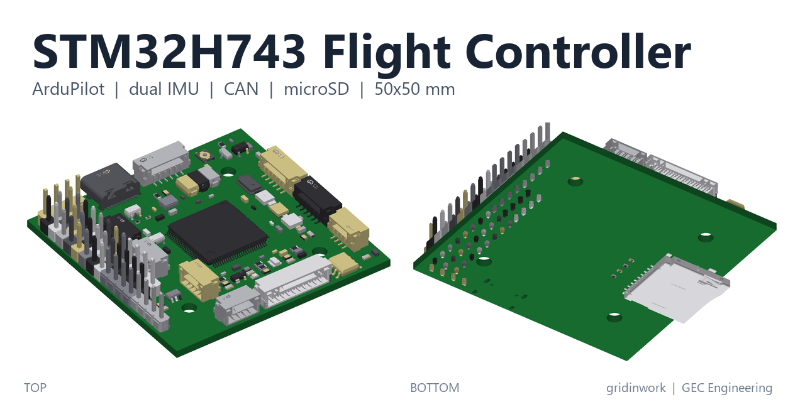
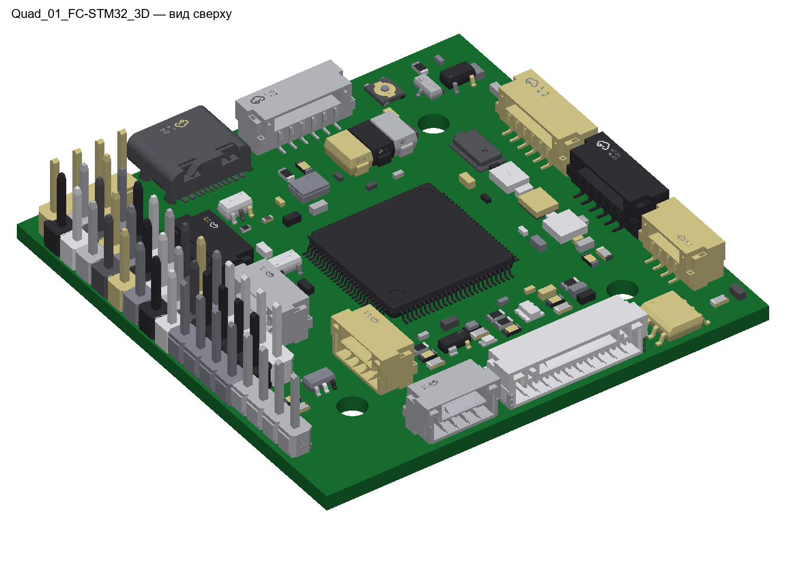
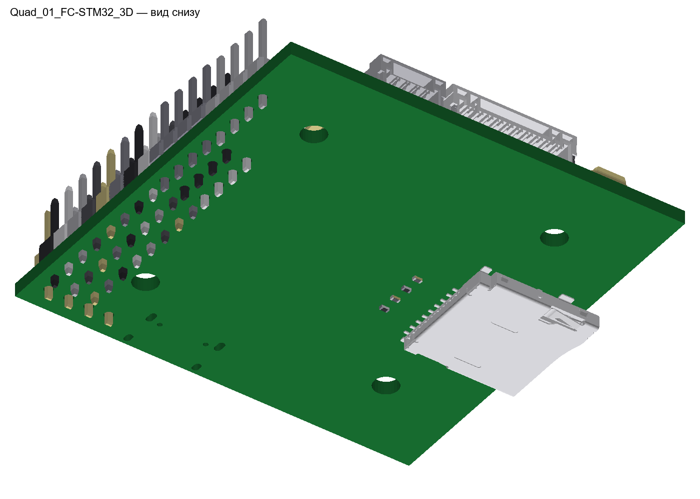
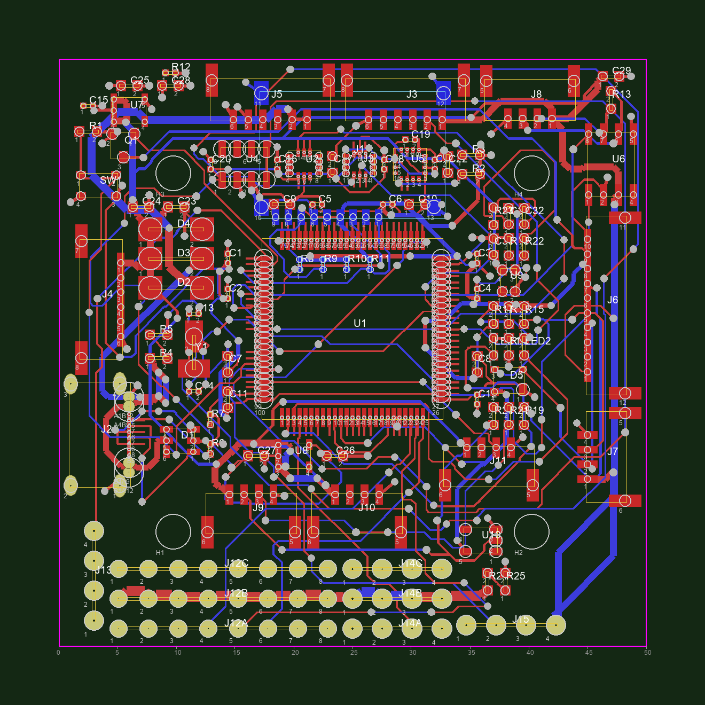

# STM32H743 Flight Controller (ArduPilot)

Open-source flight controller for quadcopters and other multirotor drones, in the class of Pixhawk 2.4.8 / Matek H743. It runs **ArduPilot** (Copter): stabilisation, GPS navigation, geofence, failsafe, microSD logging, two MAVLink telemetry ports, gimbal control and DroneCAN. Designed for a 6S quadcopter; **50 x 50 mm**, 30.5 x 30.5 mm mounting holes, 4-layer PCB.

## Highlights

| Block | Part |
|---|---|
| MCU | STM32H743VIT6, 480 MHz, 2 MB flash, 8 MHz crystal |
| IMU 1 / IMU 2 | IIM-42652 (SPI1) / BMI270 (SPI4), mounted on a vibration-isolated area |
| Barometer / compass | MS5611 (SPI2) / IST8310 (I2C1), external GPS compass on I2C2 |
| CAN | TJA1051T/3 (DroneCAN) |
| Storage | microSD (SDMMC, 4-bit) |
| USB | USB-C with USBLC6-2SC6 protection |
| Power | 5 V from the power module or USB (diode OR), 2 x XC6220 3.3 V LDO (MCU / sensors) |
| Power monitor | analog POWER port + INA226 on I2C |

**Ports** (JST-GH): TELEM1 (UART7 with RTS/CTS) - telemetry radio, TELEM2 (USART2) - video link, GPS1 (USART1 + I2C2 + safety switch), RC (USART6, CRSF/SBUS), UART3 (gimbal), UART8 (spare), UART4 (ESC telemetry), CAN1, I2C, POWER; **12 PWM/DShot outputs** + WS2812 on 2.54 mm headers; buzzer; SWD.

Pair it with the [power module](https://github.com/gridinwork/Power-Module-PDB-Current-Sensor) and the [433 MHz LoRa telemetry](https://github.com/gridinwork/LoRa-433-1W-Telemetry-Air-Module-mLRS).

## Status (work in progress)

- Schematic: complete (96 components, 101 nets), checked against the pin map and the ArduPilot hwdef.
- PCB: components placed by zones, nets assigned, **routing is not finished** (some nets still have to be routed by hand), copper pours / 4-layer stack / DRC are not done. Not all connectors fit the 50 x 50 mm outline yet.
- Firmware: ArduPilot Copter builds without errors for this board; **nothing has been tested on hardware** - the board has not been manufactured.
- Use this repository as a reference design; do not order the board before routing and DRC are finished.

## Gallery

| 3D (top) | 3D (bottom) |
|---|---|
|  |  |

| Schematic | PCB layout (current state) |
|---|---|
|  |  |

## Repository layout

| Path | Content |
|---|---|
| `hardware/EasyEDA/` | EasyEDA Pro project (`.epro2`), schematic and PCB PDF/PNG, 3D STEP model with components, netlist, BOM and CPL (JLCPCB format) |
| `images/` | 3D renders (top/bottom), schematic and PCB previews |
| `docs/` | Design documentation: requirements, pin map, BOM notes, full board description (**written in Russian**) |
| `firmware/` | ArduPilot `GEC-H743` board definition (`hwdef.dat`), build patches, build report and pre-built Copter binaries |

## How to open the design

1. Install [EasyEDA Pro](https://pro.easyeda.com/) (free).
2. *File -> Import -> EasyEDA Pro* and select `hardware/EasyEDA/Quad_01_FC-STM32.epro2`.
3. The 3D model (`*_3D.step`) opens in any CAD (SolidWorks, Fusion, FreeCAD, Blender with a STEP importer).

## Bill of materials

Parts are chosen from the LCSC/JLCPCB catalogue (LCSC numbers are in `hardware/EasyEDA/*_BOM.xlsx` and `docs/BOM.md`). Stock levels change daily - **re-check availability before ordering**. `*_CPL.xlsx` is the pick-and-place file for JLCPCB assembly.

## License

Hardware (schematic, PCB, 3D model, documentation): **CERN-OHL-P-2.0** (see `LICENSE`).

Firmware sources written for this project: **MIT** (`LICENSE-MIT`). Pre-built binaries of third-party firmware keep the licenses of their projects - see `firmware/README.md`.

Part of the [DIY Quadcopter Hardware](https://github.com/gridinwork/DIY-Quadcopter-Hardware) project by Oleg Gridin, GEC Engineering.
